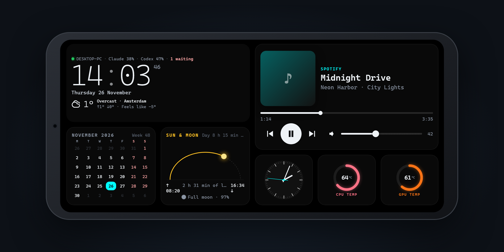
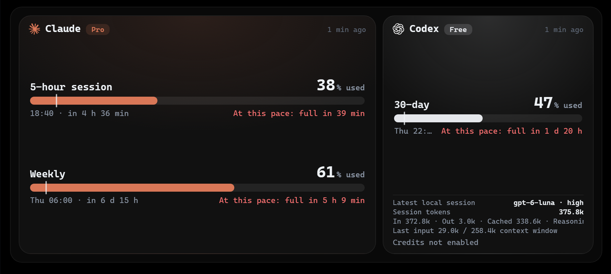
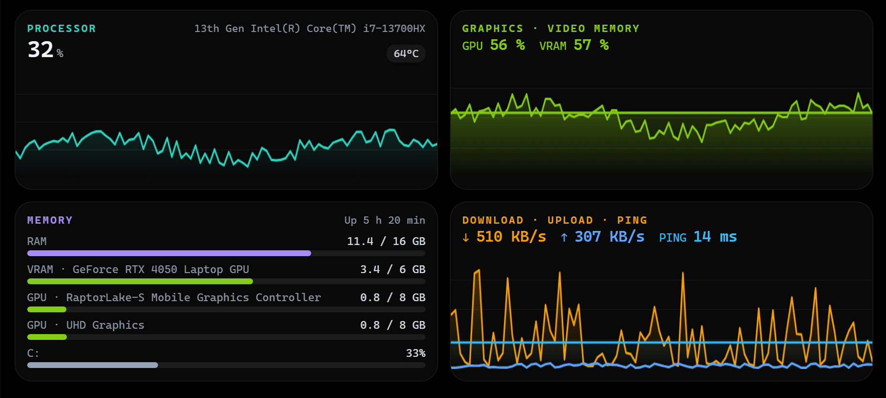
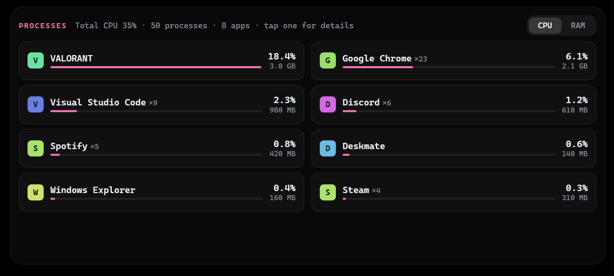
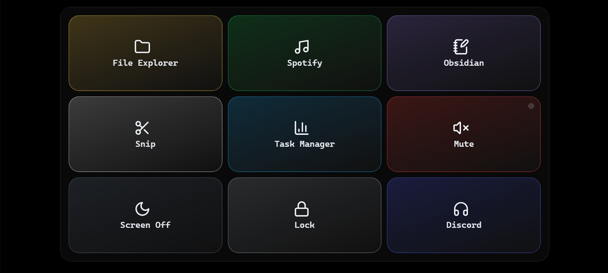
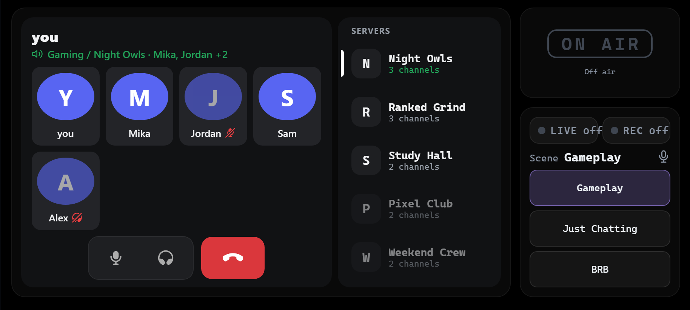
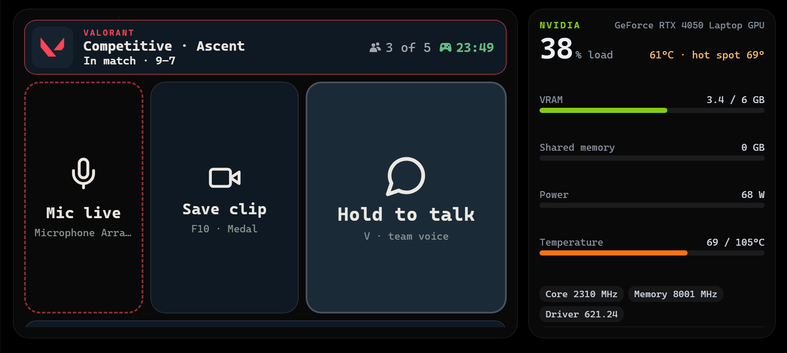
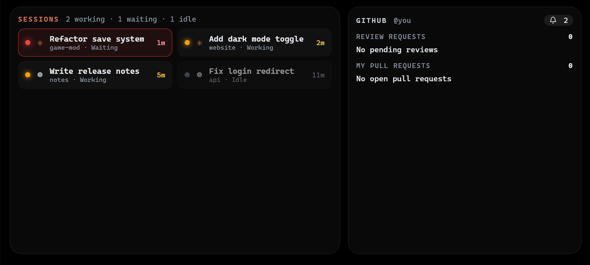

# Deskmate

**Turn an old Android phone into a desk panel for your Windows PC.**

## What it does

- 📊 **Live PC stats:** CPU, GPU, RAM, network, temperatures and the processes using the most.
- 🤖 **AI usage limits:** your Claude and Codex quotas as bars, with reset times.
- 🎧 **Discord voice:** mute, deafen and hang up, see who's talking, jump between your favourite servers.
- 🎯 **VALORANT page:** opens by itself when the game starts. Shows the match, has buttons to save a clip and hold to talk, and lists your stats.
- 🎵 **Media and shortcuts:** control any music player, and launch apps or lock the PC with one tap.

The phone connects over **USB or Wi-Fi**. You only download **one file**: the PC app has the phone app, the USB tool and the temperature driver built in.

## Install in 3 steps

1. **Download and open [DeskmateAgent.exe](https://github.com/harshbachun/Deskmate/releases/latest/download/DeskmateAgent.exe).**
   It installs itself, starts with Windows, and puts an icon in the system tray.
2. **Turn on USB debugging on your phone.**
   Settings › About phone › Software information › tap **Build number** 7 times. Then Settings › Developer options › **USB debugging**.
3. **Plug the phone into the PC.**
   Accept *Allow USB debugging?* on the phone (tick *Always allow*). Deskmate installs the phone app and opens the panel.

To change the layout, pages, shortcuts and more, double-click the tray icon. It opens the settings page at http://127.0.0.1:8765.

## Pages

| | |
|:---:|:---:|
|  **Home**: clock, weather, music, calendar, temperatures |  **AI quotas**: Claude and Codex limits, and when they reset |
|  **System**: CPU, GPU, memory and network graphs |  **Processes**: what's using your PC; tap one to close it |
|  **Shortcuts**: one-tap apps, mute, screen off and lock |  **Discord**: voice controls, your servers, OBS scenes |
|  **VALORANT**: match status, save clip, hold to talk |  **Music**: big player controls for whatever is playing |
|  **Sessions**: your Claude Code and Codex sessions, and GitHub | |

*Screenshots use made-up data.*

## Requirements

- **PC:** Windows 10 or 11 (64-bit).
- **Phone:** any Android phone or tablet with Android 5.0 or later, and a USB cable. After setup you can use Wi-Fi instead.

## FAQ

<b>Windows says "Windows protected your PC"</b>

The exe isn't code-signed, so SmartScreen warns about it. Click **More info › Run anyway**.

<b>The phone app didn't install</b>

- Check that **USB debugging** is on, and that you accepted the prompt on the phone.
- Try another cable or port; some cables only charge.
- On the phone, set the USB mode to **File transfer**.
- Settings › General › **Install the phone app** tries again.

<b>CPU temperature doesn't show</b>

Reading it needs a small sensor driver (PawnIO), which is built into Deskmate. Tray icon › **Set up CPU temperature…** then click **Yes** on the Windows admin prompt. You only do this once.

<b>Can I use Wi-Fi instead of USB?</b>

Yes. Go to Settings › General › Wi-Fi › **Pair a phone over Wi-Fi**, and scan the QR code with the phone. When Windows Firewall asks, allow Deskmate on **Private** networks. The PC and the phone must be on the same network.

<b>How do I set up Discord?</b>

Deskmate talks to the Discord app on your PC. It needs a free Discord developer application: see [docs/DISCORD.md](docs/DISCORD.md).

<b>How do I update?</b>

Download the new DeskmateAgent.exe and open it. Your settings are kept. The next time the phone is plugged in, it gets the matching phone app.

<b>How do I uninstall?</b>

1. Tray icon › **Quit**.
2. Delete `%LOCALAPPDATA%\Deskmate` and `%APPDATA%\Deskmate` (your settings).
3. Delete the Deskmate shortcuts in the Start menu and the Startup folder.
4. Uninstall the app on the phone.
5. If you set up CPU temperature, also run `schtasks /Delete /TN "Deskmate sensors" /F` in an admin terminal. Remove **PawnIO** from Installed apps if nothing else uses it.

<b>Does it send my data anywhere?</b>

No. Deskmate has no account and no server of its own: the phone talks only to your PC. A few optional widgets fetch public data, such as the weather. See [PRIVACY.md](PRIVACY.md).

## Credits

Deskmate is based on [PhoneBox](https://github.com/ersinkoc/phonebox) by Ersin Koç (MIT, see [LICENSE](LICENSE)). The third-party parts are listed in [THIRD-PARTY-NOTICES.txt](agent/Deskmate.Agent/THIRD-PARTY-NOTICES.txt). Want to build it yourself? See [BUILDING.md](BUILDING.md).
