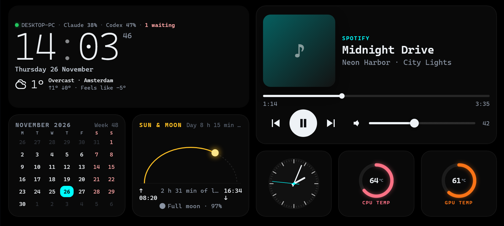
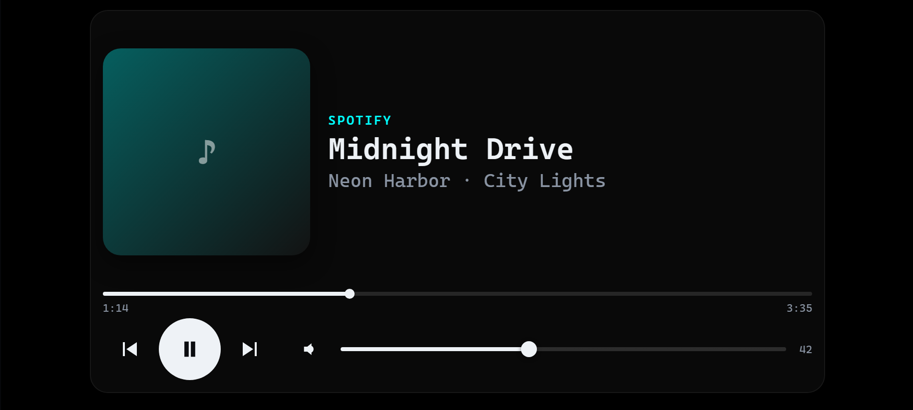

 

 

 

<h2 align="center">Features</h2>

Everything your PC is doing, on a screen that sits next to your keyboard.

 

<h2 align="center">Install</h2>

Three steps, about two minutes. No other installs.

<b>Step by step</b>

1. **Download and open [DeskmateAgent.exe](https://github.com/harshbachun/Deskmate/releases/latest/download/DeskmateAgent.exe).**
   It installs itself, starts with Windows, and puts an icon in the system tray.
2. **Turn on USB debugging on your phone.**
   Settings › About phone › Software information › tap **Build number** 7 times. Then Settings › Developer options › **USB debugging**.
3. **Plug the phone into the PC.**
   Accept *Allow USB debugging?* on the phone (tick *Always allow*). DeskMate installs the phone app and opens the panel.

To change the layout, pages, shortcuts and more, double-click the tray icon. It opens the settings page at http://127.0.0.1:8765.

 

<h2 align="center">Pages</h2>

Swipe between them on the phone, or pick which ones you want in the settings.

| | |
|:---:|:---:|
|  **Home**: clock, weather, music, calendar, temperatures |  **AI quotas**: `Claude` and `Codex` limits, and when they reset |
|  **System**: `CPU`, `GPU`, memory and network graphs |  **Processes**: what's using your PC; tap one to close it |
|  **Shortcuts**: one-tap apps, mute, screen off and lock |  **Discord**: voice controls, your servers, OBS scenes |
|  **VALORANT**: live match, mic, save clip, hold to talk, `GPU` stats |  **Music**: big player controls for whatever is playing |
|  **Sessions**: your `Claude Code` and `Codex` sessions, and GitHub | |

The VALORANT, Shortcuts and Music screenshots are from a real PC; the others use made-up data.

 

<h2 align="center">Requirements</h2>

<table align="center">
<tr>
<td align="center" width="50%"><h3>PC</h3><code>Windows 10/11</code> · <code>64-bit</code> Nothing else to install</td>
<td align="center" width="50%"><h3>Phone</h3><code>Android 5.0</code> or later Any phone or tablet, plus a USB cable. Wi-Fi works after setup.</td>
</tr>
</table>

 

<h2 align="center">FAQ</h2>

<b>Windows says "Windows protected your PC"</b>

The exe isn't code-signed, so SmartScreen warns about it. Click **More info › Run anyway**.

<b>The phone app didn't install</b>

- Check that **USB debugging** is on, and that you accepted the prompt on the phone.
- Try another cable or port; some cables only charge.
- On the phone, set the USB mode to **File transfer**.
- Settings › General › **Install the phone app** tries again.

<b><code>CPU</code> temperature doesn't show</b>

Reading it needs a small sensor driver (PawnIO), which is built into DeskMate. Tray icon › **Set up CPU temperature…** then click **Yes** on the Windows admin prompt. You only do this once.

<b>Can I use Wi-Fi instead of USB?</b>

Yes. Go to Settings › General › Wi-Fi › **Pair a phone over Wi-Fi**, and scan the QR code with the phone. When Windows Firewall asks, allow DeskMate on **Private** networks. The PC and the phone must be on the same network.

<b>How do I set up Discord?</b>

DeskMate talks to the Discord app on your PC. Send your Discord username to whoever shared DeskMate with you so they can add you to DeskMate's tester list, accept the invite, then turn on **Settings › General › Discord › Connect to Discord** and click **Authorize** in Discord. Details: [docs/DISCORD.md](docs/DISCORD.md).

<b>How do I update?</b>

Download the new DeskmateAgent.exe and open it. Your settings are kept. The next time the phone is plugged in, it gets the matching phone app.

<b>How do I uninstall?</b>

1. Tray icon › **Quit**.
2. Delete `%LOCALAPPDATA%\Deskmate` and `%APPDATA%\Deskmate` (your settings).
3. Delete the DeskMate shortcuts in the Start menu and the Startup folder.
4. Uninstall the app on the phone.
5. If you set up `CPU` temperature, also run `schtasks /Delete /TN "Deskmate sensors" /F` in an admin terminal. Remove **PawnIO** from Installed apps if nothing else uses it.

<b>Does it send my data anywhere?</b>

No. DeskMate has no account and no server of its own: the phone talks only to your PC. A few optional widgets fetch public data, such as the weather. See [PRIVACY.md](PRIVACY.md).

 

---

DeskMate is based on <a href="https://github.com/ersinkoc/phonebox">PhoneBox</a> by Ersin Koç · <a href="LICENSE">MIT license</a> · <a href="agent/Deskmate.Agent/THIRD-PARTY-NOTICES.txt">Third-party notices</a> · <a href="BUILDING.md">Build it yourself</a>

